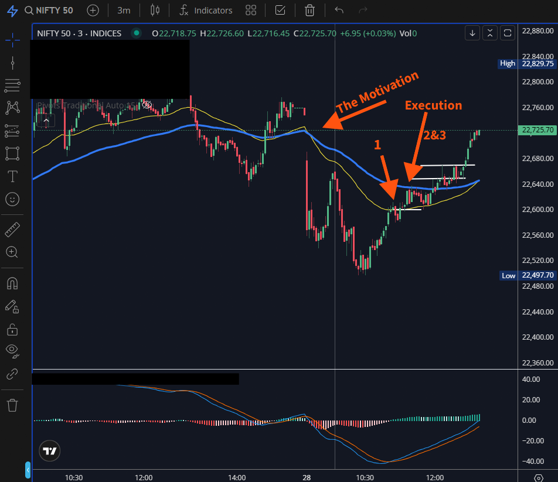
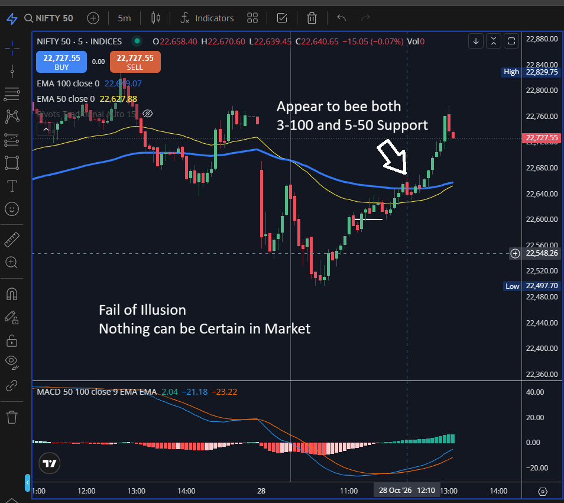
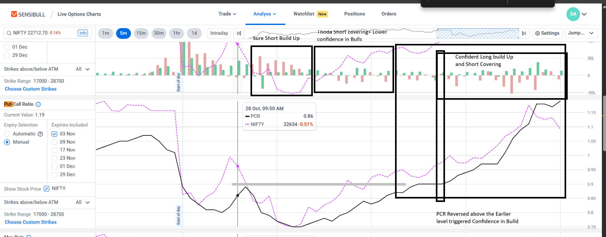
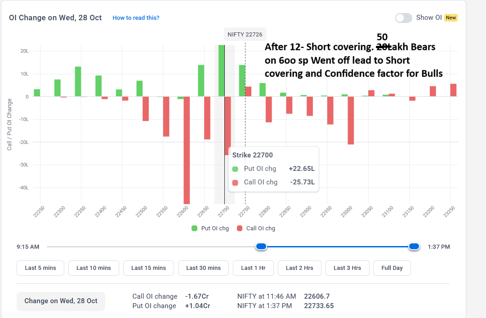
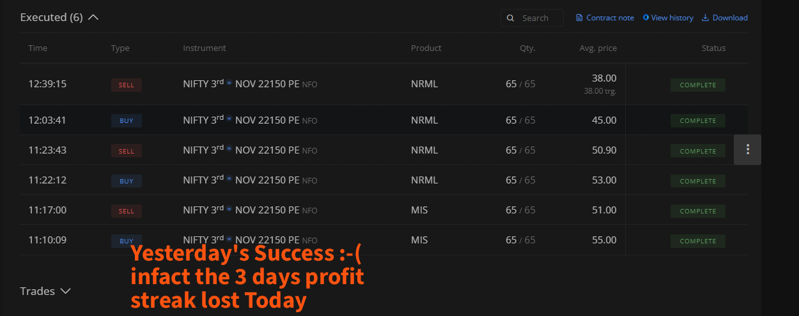
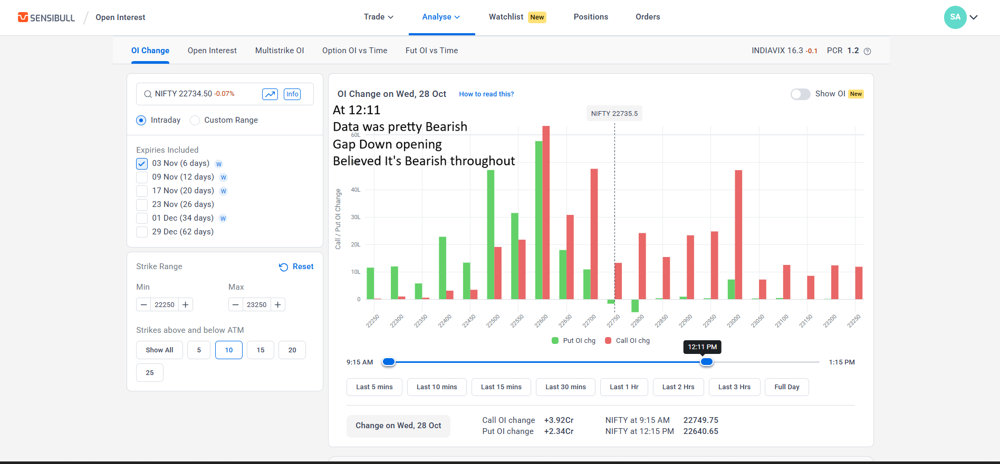

# Wed-281026
Readme bro...

Sabse FIRST
The Premiums you selected were damn OTM with Delta 0.12 means tere ko Market kitna move karna padega 500 Rs ke liye = 65 Nifty Spot points. Damn Un-Real. Teri haar to pakki thi. Ho Bhi gaya, say 150 points gaya. Rere ko 1100 Rs de Jayega. Avoid unless kuch Bhayanak Trade mile

Make a habit from today
1. Overtrading avoid kar
2. Clarity ke without don't f*ckin trade
3. Big Profit--- Take a Break- Atleast 1 day- let it wear off. Tu kal 50% pe tha 1500 profit pe. on 3K capital. Now 500 means direct +16.66%.
4. The Setup can be failed. Deal with it. Nothing is black and white. Binary world would never existed. maintain good Strike rate.
5. you took 3 trades. not at all over trading. But you give away 13 points. aane ko to 8 point bas karta. work on it.
6. Zero is Perfectly fine. If some trade is achieving Highs, let it with sl on entry.

Motivation behind Entering 

Setup Fail POC

Data Reversal against my position
1. 

2. 

Still a Acceptable composed OT

Proactive way to identify Reversal

